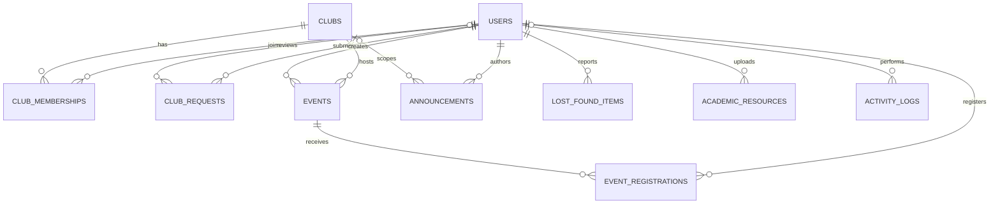
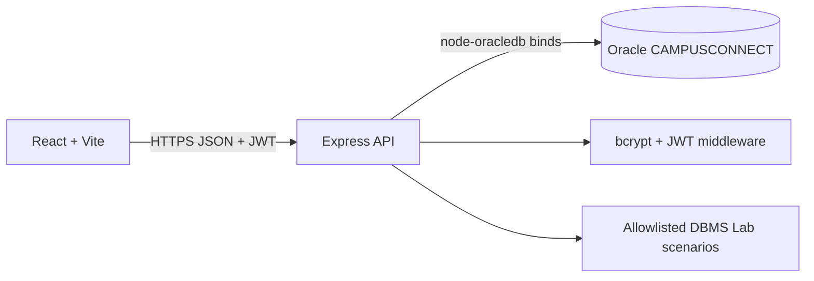

# CampusConnect project report

## A. Requirements

**Problem.** Campus announcements, clubs, events, academic notes and lost property are often spread across informal channels. Students need one authenticated portal with reliable relational data and clear ownership.

**Objectives.** Provide role-aware discovery and submissions; preserve referential integrity; demonstrate Oracle SQL/PL/SQL in a safe lab; and report live aggregate counts from the same database.

**Functional requirements.** Register/login/profile; find/join clubs; create and register for events; publish announcements; report/resolve items; share academic resources; admin review of club requests and user roles; paginate/filter events; perform allowlisted CRUD/query demonstrations; show XML, views, procedures and measured query plans.

**Non-functional requirements.** Passwords use bcrypt; JWTs expire; role checks run in Express; database access uses bind variables and an allowlisted query catalog; database credentials remain on the server; mobile layouts adapt; errors do not disclose hashes or stack traces in production.

## B. Conceptual design

`CLUB_MEMBERSHIPS` resolves the many-to-many student/club relationship. `EVENT_REGISTRATIONS` resolves the many-to-many user/event relationship. Club-wide announcements use nullable `club_id`; null denotes campus-wide. Audit rows are append-only history and intentionally do not foreign-key to deleted event rows.

## C. Logical design and normalization

The schema uses one fact per row. USERS stores person attributes once; CLUBS stores club attributes once; membership attributes depend on `(user_id, club_id)`. Event registration attributes depend on `(event_id, user_id)`. Club and event names are not copied into relationship rows. These relations satisfy 1NF (atomic columns), 2NF (non-key attributes depend on each whole candidate key), and 3NF (no non-key attribute determines another non-key attribute in the designed relations).

Representative functional dependencies:

- `user_id → full_name, email, password_hash, enrollment_number, department, year_of_study, role`
- `club_id → club_name, description, category, logo_url`
- `(user_id, club_id) → membership_role, membership_status, joined_at`
- `event_id → club_id, created_by, title, venue, start_datetime, end_datetime, capacity, event_status`
- `(event_id, user_id) → registration_status, registered_at`

Primary keys uniquely identify rows. Email and optional enrollment number are unique. Check constraints restrict role/status values, positive capacity, event chronology and valid year/semester ranges. FKs default to restrictive deletion so business history is not silently cascaded away.

## D. Physical design

Oracle types use `NUMBER`, `VARCHAR2`, `CLOB`, `TIMESTAMP WITH TIME ZONE`, identity-generated keys, named checks and unique constraints. Composite indexes in `02_indexes.sql` support event status/date browsing, membership status, registration lookup and dashboard activity. Indexes are candidates to measure, not a guarantee of faster work. Views in `03_views.sql` centralize event counts, capacity aggregates and active memberships.

The app uses a shared least-privilege Oracle account. Public app roles cannot directly update `USERS.ROLE`; role changes and request approval are definer-rights procedures which verify an administrator ID against USERS. In production, database credentials and wallet/network access must be protected as secrets.

## E. Development and testing

The browser never connects to Oracle and cannot submit SQL. Lab operations choose fixed server-side scenarios, table and column allowlists, operators and bind values. XML is serialized from actual result rows in the API; XML element values are escaped and nulls use `xsi:nil`. Query 1/3/4 alone expose XML.

Unit tests cover health, unauthenticated protected routes, arbitrary-scenario rejection, XML escaping/null representation, and pagination bounds. An opt-in Oracle integration check verifies schema table presence. Oracle was not configured while preparing this project, so stored programs, triggers, benchmark timings and Oracle integration remain to be executed locally; no Oracle test result is claimed.

## F. Presentation sequence

1. Register a student and show bcrypt-backed login/profile.
2. Browse clubs; join a club and submit a club proposal.
3. Sign in as admin; approve a request and change a user role.
4. Sign in as coordinator; create an event, publish an announcement and demonstrate registration capacity.
5. Submit lost-and-found and resource records; update an owned record.
6. Open DBMS Lab: display/insert/update/delete, filters, aggregates, joins, subqueries, XML, ref-cursor procedure, view insert and timed benchmark.
7. In SQLcl, show trigger source, audit rows, cursor procedure, role grants, query plans and time-rule boundary cases.

## Architecture notes

The `CAMPUSCONNECT` application schema is distinct from the application user table. Application roles are `STUDENT`, `COORDINATOR`, `ADMIN`. Registration always sets STUDENT server-side. A coordinator can create events only for clubs where an active COORDINATOR membership exists. Admin screens are server protected as well as conditionally displayed.
